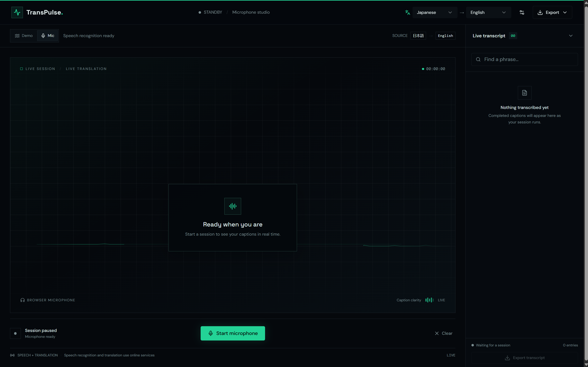
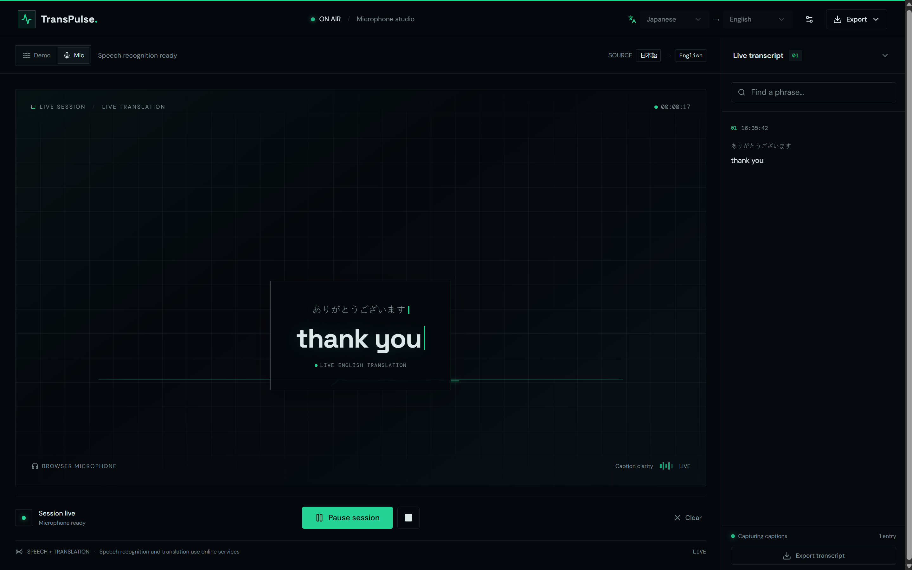

<div align="center">

# TransPulse

### Live captions, in the moment.

A focused, bilingual captioning studio for watching a simulated conversation or
capturing speech from your microphone—with a searchable transcript ready to copy
or export.


</div>

---

## Contents

- [At a glance](#at-a-glance)
- [Previews](#previews)
- [The studio](#the-studio)
- [Features](#features)
- [Getting started](#getting-started)
- [Using the studio](#using-the-studio)
- [Browser and network requirements](#browser-and-network-requirements)
- [Technology](#technology)
- [Project structure](#project-structure)
- [Development commands](#development-commands)
- [Tests](#tests)

## At a glance

TransPulse is a responsive, dark-themed web studio for viewing live-style
captions. Choose a **Demo** to preview prepared conversations, or use **Mic** to
transcribe and translate microphone audio. Completed captions appear in a
transcript panel where they can be searched, copied, cleared, or downloaded.

| | |
| --- | --- |
| **Modes** | Prepared demo conversations and microphone transcription |
| **Languages** | Automatic source-language detection plus Japanese, Hindi, Spanish, German, French, Korean, and English |
| **Transcript exports** | Plain text (`.txt`), SubRip subtitles (`.srt`), and JSON (`.json`) |
| **Layout** | Responsive studio with a caption stage, session controls, and transcript |

## Previews





## The studio

The interface is arranged around a live caption stage and a transcript sidebar:

1. **Studio header** — select the source and caption languages, open subtitle
   settings, and access transcript exports.
2. **Session toolbar** — switch between Demo and Mic, select a demo conversation,
   and see the current language pair.
3. **Caption stage** — view the current original and translated text, session
   timer, and animated audio visualization.
4. **Session controls** — start or pause a session, stop a running session,
   adjust demo pace, and clear the transcript.
5. **Live transcript** — search completed captions, copy an entry, collapse the
   panel, or export the session.

The compact layout adapts for smaller screens, with language selectors moving
into a second header row.

## Features

- **Demo conversations:** choose a prepared tech keynote, casual conversation,
  or team meeting. Demo captions are simulated from bundled sample lines; they
  do not play or analyze audio.
- **Microphone captions:** record short microphone clips and transcribe them
  through a server-side speech service only when audible speech is detected,
  then translate recognized text only when its language differs from the
  selected caption language. Automatic source detection supports English and
  Japanese speech. Local audio processing keeps the microphone stream
  continuous, skips silent clips, and overlaps transcription windows slightly
  to reduce clipped words.
- **Hindi support:** select Hindi (हिन्दी) as either the source or caption
  language.
- **High-visibility captions:** English translations start at a larger size
  than the original speech, and the stage shows an animated ECG-style signal
  while a session is live.
- **Bilingual display:** show or hide the original text above the translated
  caption.
- **Caption customization:** adjust subtitle size and backdrop opacity.
- **Transcript tools:** filter completed entries, copy an individual caption,
  clear the session transcript, or export the full transcript.
- **Accessible session feedback:** the current caption stage is announced as a
  live region, controls have accessible names, and session notices are exposed
  as status messages.
- **Honest status and errors:** the interface reports unsupported recording,
  microphone permission problems, and translation failures rather than
  presenting them as successful captions.

## Getting started

### Requirements

- Node.js and npm
- A modern browser for the web app
- For microphone mode: browser microphone permission, a secure context
  (`localhost` is suitable for local development), and a Groq API key

### Install and run

```bash
git clone https://github.com/skumar-webtech/pixel-perfect-replica.git
cd pixel-perfect-replica
npm ci
npm run dev
```

Open the local URL printed by Vite in your terminal.
Create a Groq API key at [console.groq.com/keys](https://console.groq.com/keys)
and add these server-only settings to the project-root `.env` file:

```dotenv
GROQ_API_KEY=your-groq-api-key
GROQ_TRANSCRIPTION_MODEL=whisper-large-v3-turbo
```

Restart the dev server after changing `.env`. `GROQ_MODEL` is a chat model
setting and is not used for audio transcription; the transcription endpoint
requires a Whisper model. `.env` is git-ignored and must never be committed.
For Cloudflare deployments, configure `GROQ_API_KEY` as a Worker secret (for
example, with `npx wrangler secret put GROQ_API_KEY`). Never use a `VITE_`
variable or commit the key to source control. Groq's free-tier limits and
availability can change; check its current account limits before use.

To create and preview a production build:

```bash
npm run build
npm run preview
```

## Using the studio

### Try a demo

1. Select **Demo**.
2. Choose **The next era of computing**, **A long-awaited reunion**, or
   **Making the work matter**.
3. Select the source and caption languages in the header.
4. Choose **Start session**. Use the pace slider to change how quickly the
   prepared captions appear.
5. Search or copy completed entries in the transcript, or choose an export
   format.

### Use a microphone

1. Select **Mic**. Leave the source language at **Auto detect** to handle both
   English and Japanese, or select a specific language.
2. Choose **Start microphone** and grant microphone access when prompted.
3. Speak into the microphone or play speech from another phone near it. Captions
   appear in short audio batches. Choose **Pause session** to stop capture, or
   the square stop control to end the session.

Microphone mode requires a browser with `getUserMedia` and `MediaRecorder`
support. Demo mode remains available without microphone access.

### Customize captions and export

- Open **Subtitle settings** to change text size, backdrop opacity, and whether
  the original caption is shown.
- Search the transcript with **Find a phrase…**. Search covers both original
  and translated text.
- Use the copy icon on an entry to copy its original and translated text.
- Choose **Export** and select `.txt`, `.srt`, or `.json`. Export is available
  after at least one caption has been recorded.

## Browser and network requirements

- **Microphone mode** records audio in the browser and sends short clips to the
  server-side Groq transcription API. It requires microphone permission, a
  configured `GROQ_API_KEY` server secret, and network access. A best-effort
  per-worker limit allows 20 requests per minute per Cloudflare client IP, and
  clips larger than 10 MB are rejected. Audio is checked locally for activity
  before upload; silent 10-second segments are discarded. Active clips are
  converted locally to mono 16 kHz WAV and overlap by 800 ms to prevent small
  capture gaps without increasing the transcription request rate.
- **Translation** uses the Google Translate web endpoint at
  `translate.googleapis.com`; live translation therefore requires network
  access.
- **Demo mode** uses bundled sample captions and does not require microphone
  access.
- Audio is sent to Groq for transcription and recognized text is sent to the
  Google Translate web endpoint for translation. Do not treat this app as an
  offline or privacy-isolated captioning system.
- The `.srt` export formats entries into four-second subtitle intervals; these
  are generated intervals, not measured speech timestamps.

## Technology

| Area | Tools |
| --- | --- |
| Application | React 19, TypeScript, TanStack Start, TanStack Router |
| Styling | Tailwind CSS 4, custom studio styles |
| UI components | Radix UI primitives, shadcn-style components, Lucide icons |
| Build and development | Vite |
| Tests | Vitest, Testing Library, jsdom |

## Project structure

```text
src/
├── components/ui/       Reusable interface components
├── lib/
│   └── translate-caption.ts
├── routes/
│   ├── __root.tsx       Root document, metadata, and app providers
│   └── index.tsx        TransPulse captioning studio
├── test/                Routing and translation tests
├── router.tsx           Router setup
└── styles.css           Theme and studio styles
```

The app uses TanStack file-based routing. Route components live in `src/routes`;
`src/routeTree.gen.ts` is generated and should not be edited manually.

## Development commands

| Command | Description |
| --- | --- |
| `npm run dev` | Start the Vite development server |
| `npm run build` | Build the production application |
| `npm run build:dev` | Build using development mode |
| `npm run preview` | Serve the production build locally |
| `npm test` | Run the Vitest test suite once |
| `npm run test:watch` | Run Vitest in watch mode |
| `npm run lint` | Check the project with ESLint |

## Tests

Run all tests with:

```bash
npm test
```

The tests cover route matching and caption translation behavior, including
same-language short-circuiting, joining translated text segments, and reporting
translation service errors.

---

<div align="center">

Built with React, TypeScript, and TanStack Start.

</div>
